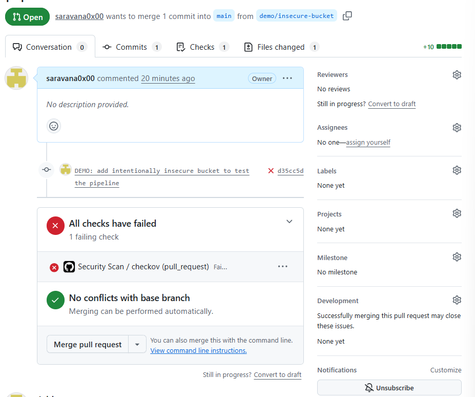
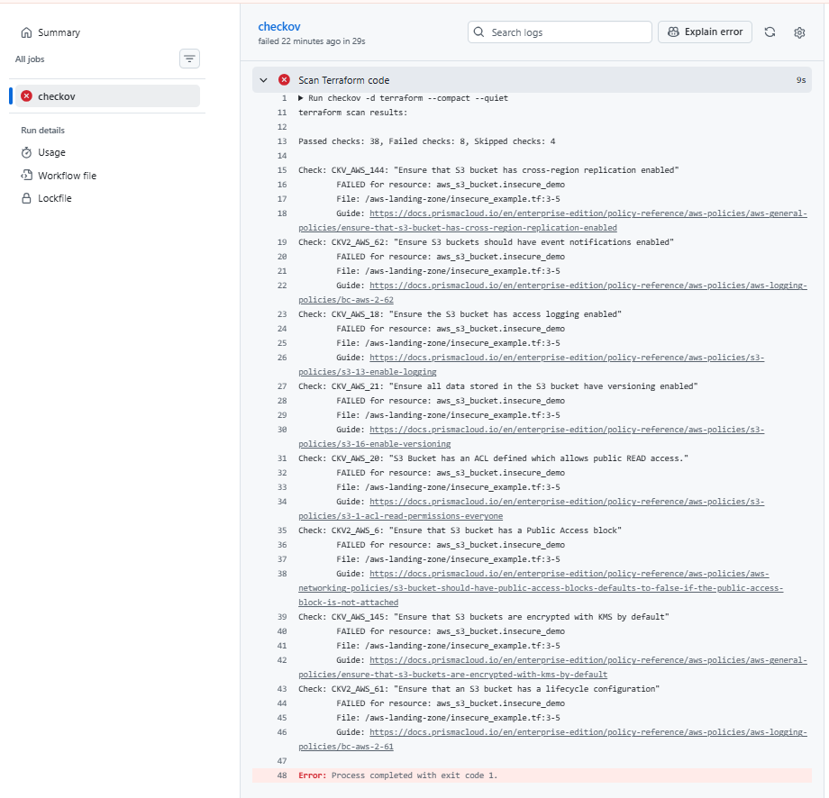
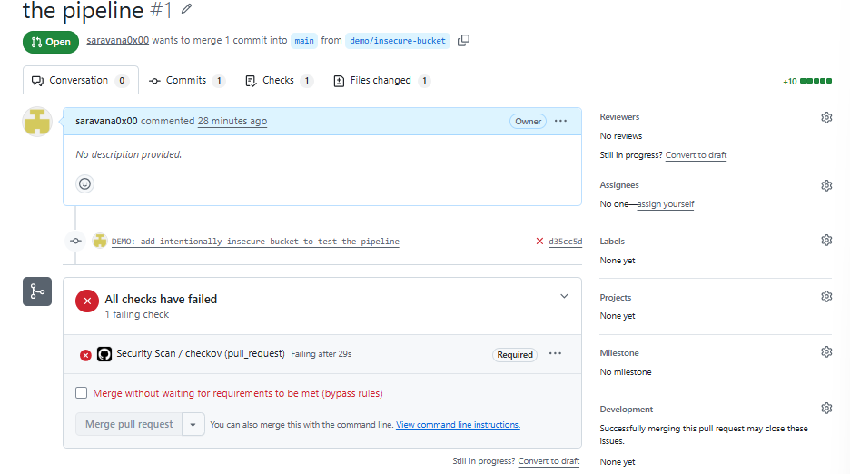

# Secure Cloud Platform

A hands-on reference architecture for secure-by-default, multi-cloud platforms.
Built as a portfolio project to demonstrate cloud security engineering skills.

## What this project covers

| Folder | Focus |
|--------|-------|
| terraform/ | Secure AWS landing zone and a second-cloud baseline, as code |
| kubernetes/ | Cluster hardening, runtime detection, service mesh mTLS |
| policy-as-code/ | OPA/Rego and Kyverno guardrails with tests |
| pipelines/ | CI/CD security gates: IaC scanning, image scanning, signing |
| automation/ | Auto-remediation and custom security tooling |
| cspm/ | Posture scanning and risk reporting |
| compliance/ | Control mapping to NIST 800-53 / FedRAMP |
| docs/ | Architecture, threat model, ADRs, executive brief |

## Status

## Security guardrails in action

Every push and pull request is scanned with [Checkov](https://www.checkov.io/).
To prove the guardrail works, I opened a pull request containing an intentionally
insecure S3 bucket (public-read ACL, no encryption, no public access block).
The pipeline rejected it, and branch protection blocked the merge.

**The pull request fails the required security check:**

**The scan reports exactly what is wrong:**

**Merging is blocked until the check passes:**

### Accepted risks

Two findings are deliberately skipped on the demo buckets, with the reason
recorded next to the code: cross-region replication (doubles cost) and event
notifications (not needed for a demo). Documenting accepted risk is part of the
review process, not a way to hide findings.

Work in progress. Modules are being built one at a time.

## Disclaimer

Educational project. No real credentials or account IDs are stored in this repository.