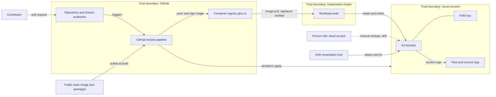

# Threat model: secure-cloud-platform

Status: version 1 (scope, assets, data flow, STRIDE analysis, residual risks).

## 1. Scope

In scope: the delivery pipeline for the sample app and the cloud baseline it would run on.

- Source code and workflows in GitHub
- The CI/CD pipeline (GitHub Actions) and its checks
- The container image and its registry (ghcr.io)
- The AWS baseline defined in Terraform: encrypted S3 buckets, a KMS key, a VPC with flow logs
- A Kubernetes cluster with enforced pod and network policies (built locally, not permanently deployed)
- The drift remediation tool

Out of scope: the sample app's business logic (it only returns "ok"), a production AWS account (everything runs
against LocalStack), end-user identity, and physical security.

## 2. Assets

| Asset | Why it matters |
|---|---|
| Source code and workflow files | Whoever changes them controls what gets built and signed |
| Signing identity (workflow identity, keyless) | Trust in the image depends on it |
| Container image in the registry | What would actually run in production |
| Data in S3 buckets | The thing the baseline exists to protect |
| KMS key | Controls who can read the encrypted data |
| Flow logs and access logs | The audit trail for investigations |
| Pipeline secrets and tokens | Short-lived GitHub tokens with write access |

## 3. Actors

- **Outside attacker:** no access, looks for exposed storage or a vulnerable image.
- **Malicious or careless contributor:** can open pull requests, may try to merge insecure changes.
- **Compromised dependency:** a vulnerable or tampered package or base image.
- **Insider with cloud access:** can change a setting by hand after deployment (drift).

## 4. Data flow and trust boundaries

Each arrow that crosses a boundary box is a place to examine in the STRIDE analysis.

## 5. STRIDE analysis

S = Spoofing, T = Tampering, R = Repudiation, I = Information disclosure, D = Denial of service, E = Elevation of privilege.

| # | Boundary | Threat | STRIDE | Controls in place | Residual risk |
|---|---|---|---|---|---|
| 1 | Contributor to repository | An insecure Terraform, Kubernetes or image change is merged | T, E | Branch protection with four required checks (checkov, conftest, image-scan, pytest) | Repo admin can bypass; no required human review; checks only catch what the rules cover |
| 2 | Contributor to repository | A pull request edits a workflow file to weaken or remove a check | T | Workflow changes go through the same pull request flow | Nothing verifies the workflows themselves; no required reviewer |
| 3 | Public sources to pipeline | A third-party action or tool image is compromised | T | Actions pinned to major versions | Actions use version tags, not commit SHAs; Trivy and Conftest images use `latest` |
| 4 | Public sources to pipeline | The base image or a package has a known vulnerability | T | Trivy gate on fixable HIGH and CRITICAL findings; patched package; SBOM per build | Unfixable findings are tracked, not blocked; base image referenced by tag |
| 5 | Pipeline to registry | An image is replaced or forged after the build | S, T | Keyless signature by digest; verified in the same run | Nothing checks the signature at deploy time; no admission policy in the cluster |
| 6 | Pipeline | A pipeline token is abused to push or change things | E | Per-job permissions on the signing workflow; short-lived tokens | Other workflows have no explicit permissions block |
| 7 | Pipeline | A secret is committed to the repository | I | Dummy credentials only; state files git-ignored | No secret scanning in the pipeline yet |
| 8 | Cloud account | A bucket is exposed publicly | I | Public access block; KMS encryption; Checkov rules; drift tool | Tested on LocalStack only; bucket policies and ACLs not examined by the tool |
| 9 | Cloud account | The KMS key is misused or over-shared | I, E | Rotation; explicit key policy | Account root administers the key; one key for everything; policy not tested on real AWS |
| 10 | Cloud account | Someone changes a setting by hand after deployment (drift) | T | Remediation tool detects and fixes the safe cases | Runs on demand, not on events or a schedule; no alerting |
| 11 | Cloud account | Access cannot be traced after an incident | R | S3 access logs and VPC flow logs, 365-day retention | The log bucket does not log itself; logs are not tamper-proof; no alerts |
| 12 | Kubernetes cluster | A compromised pod moves sideways or escalates | E | Restricted pod security; default-deny network policy with narrow allow rules | No runtime detection; no policy engine in the cluster beyond pod security; cluster demonstrated locally only |
| 13 | Kubernetes cluster | A workload exhausts resources | D | Memory limit required by policy; limits set in manifests | No ResourceQuota or LimitRange; CPU limits not enforced by policy |

## 6. Top residual risks, in priority order

1. **Workflow tampering and admin bypass (rows 1, 2).** A change that weakens a check can be merged, and admins can bypass protection. Fix: require a reviewer, add CODEOWNERS for the workflow folder, and disable bypass.
2. **Unpinned third-party actions and tool images (row 3).** Pin to commit SHAs and image digests.
3. **No secret scanning (row 7).** Add a secret scan to the pipeline.
4. **No signature check at deploy time (row 5).** Verify signatures with an admission policy before a pod can start.
5. **Log integrity and alerting (rows 10, 11).** Protect logs from tampering and alert on drift.

## 7. Assumptions and limits of this model

- Everything ran against LocalStack and a local cluster. Behaviour on real AWS may differ.
- This is a first version for a learning project, not a review of a production system.
- Threats were identified by walking the diagram once. A real review would repeat this with the people who run the system.